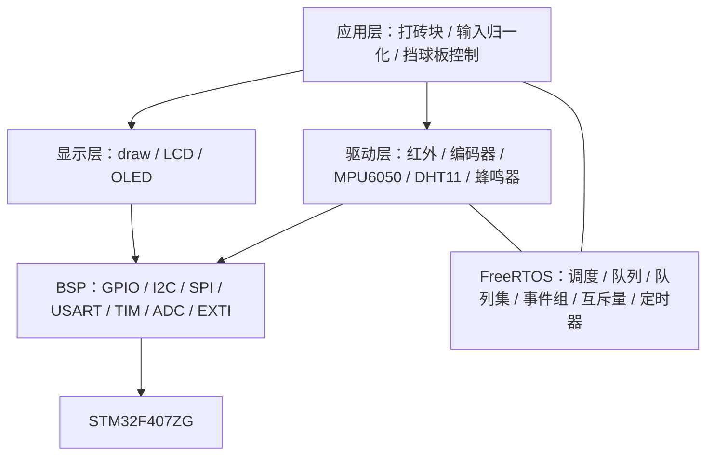
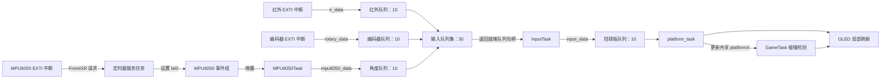
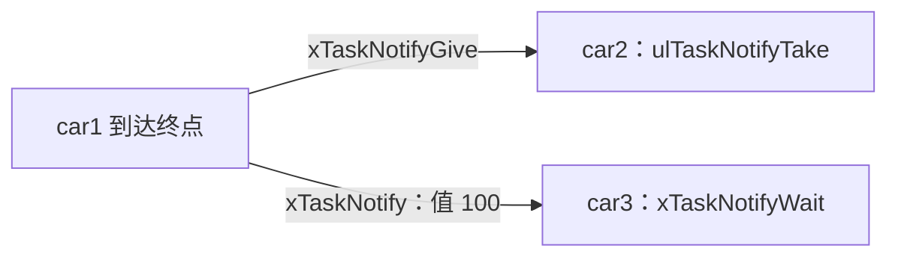

<div align="center">

# ⌚ STM32F407 · FreeRTOS 游戏手表

**把实时操作系统的任务、消息与同步机制，放进一场打砖块游戏。**


多源输入 · 队列集 · 事件组 · I²C 互斥 · 软件定时器 · 静态 / 动态任务

[快速开始](#快速开始) · [任务设计](#任务设计) · [消息如何传递](#消息如何传递) · [硬件连接](#硬件连接) · [源码导航](#源码导航)

</div>

---

## 项目简介

这是一个基于 **STM32F407ZG + FreeRTOS + STM32 标准外设库** 的游戏手表学习项目。当前默认应用是 OLED 打砖块游戏：玩家可以通过红外遥控器、旋转编码器或 MPU6050 倾斜输入控制挡球板，屏幕显示砖块、分数和生命值，蜂鸣器提供碰撞音效，DHT11 周期更新温湿度。

项目重点是展示嵌入式实时系统如何组织工作：中断产生事件，采集任务处理传感器，输入任务统一不同设备的数据，控制任务更新挡球板，游戏任务负责物理逻辑与画面。

代码包含从百问网 FreeRTOS 游戏手表工程移植而来的驱动，以及带有 N|Watch 来源声明的游戏与绘图代码。当前版本将底层外设访问改为标准库 / 寄存器实现，直接使用 FreeRTOS 原生 API。

> 当前形态是开发板上的游戏手表演示工程。仓库暂未提供完整的时钟菜单、计步、低功耗、电池管理或可穿戴硬件设计；下面的描述以现有源码为准。

## 功能一览

| 功能 | 当前实现 |
| --- | --- |
| 打砖块 | 默认启动；32 × 5 共 160 块砖，挡球板移动、碰撞、分数与生命值显示 |
| 红外控制 | 左 / 右键控制，重复码沿用上一条方向指令 |
| 编码器控制 | 方向决定左右，速度决定每次发送 1 / 2 / 4 条移动消息 |
| 倾斜控制 | MPU6050 X 轴加速度转换为角度，再映射为移动方向 |
| OLED 绘图 | 128 × 64 单色帧缓冲，位图、文字与局部刷新 |
| 温湿度 | DHT11 软件定时器每 2 秒读取并更新文字 |
| 游戏音效 | PWM 发声，单次软件定时器负责停止声音 |
| LED 心跳 | 默认启用；500 ms 亮、500 ms 灭，并打印任务栈余量 |
| 运行统计 | 空闲钩子通过串口打印任务运行时间统计 |
| 三车演示 | `nwatch/game2.c` 保留任务通知演示，默认不启动 |
| 音乐播放 | `User/music.c` 保留播放任务，默认不启动 |
| 其他外设 | 包含 W25Q64、DS18B20、超声波、光敏、彩灯等驱动，未全部接入默认游戏 |

## 技术栈

| 层次 | 技术与用途 |
| --- | --- |
| MCU | STM32F407ZG，ARM Cortex-M4；工程配置包含硬件浮点支持 |
| 系统时钟 | 源码配置 HSE 25 MHz，PLL M=25 / N=336 / P=2，SYSCLK 168 MHz |
| 外设访问 | STM32F4 标准外设库 V1.8.0、CMSIS 与寄存器访问 |
| 实时内核 | FreeRTOS V10.3.1，抢占式调度，1 kHz Tick |
| 内存管理 | `heap_4.c`；15 KiB 内核堆；同时支持静态与动态分配 |
| 消息通信 | Queue、Queue Set；队列复制结构体数据 |
| 同步机制 | Event Group、Mutex；备用三车演示使用 Task Notification |
| 周期 / 延时 | FreeRTOS 软件定时器、`vTaskDelay()`；TIM4 提供微秒计数 |
| 显示 | OLED → LCD 抽象 → `nwatch/draw.c`，1024 字节单色帧缓冲 |
| 调试 | USART1 115200；运行时间统计、栈高水位查询、`configASSERT()` |
| 开发工具 | Keil µVision 工程，ARMCC 5.06 update 5，C99 |

底层仍保留 `HAL_GPIO_EXTI_Callback()` 这个回调名称，作为移植时沿用的中断分发接口；本工程的 EXTI 配置和 IRQHandler 实现在标准库 BSP 中。任务创建也不依赖 CMSIS-RTOS v2。

## 系统架构



### 启动流程

1. 启动文件调用 `SystemInit()`，设置系统时钟。
2. `User/main.c` 初始化 GPIO、I²C、SPI、USART、PWM、TIM4、ADC 和 EXTI。
3. `MX_FREERTOS_Init()` 创建 I²C 互斥量，初始化 OLED、MPU6050、红外、编码器，创建 `GameTask` 与 `LightTask`。
4. `vTaskStartScheduler()` 启动调度；SysTick / PendSV / SVC 交给 FreeRTOS 移植层。
5. `GameTask` 初始化绘图与游戏状态，创建音效 / DHT11 定时器、输入队列集及挡球板队列，然后创建 `MPU6050Task`、`InputTask`、`platform_task`。

## 任务设计

默认应用创建 **5 个业务任务**，另外由内核运行空闲任务和定时器服务任务。FreeRTOS 优先级数值越大，优先级越高。

| 任务名称 | 入口 / 源码 | 优先级 | 栈深度 | 职责与等待方式 |
| --- | --- | ---: | ---: | --- |
| `GameTask` | `game1_task()` / `nwatch/game1.c` | 24 | 128 words | 创建游戏相关对象；移动球、检测碰撞、刷新画面；每轮 `vTaskDelay(50)` |
| `LightTask` | `Led_Test()` / `Drivers/driver_led.c` | 24 | 128 words | LED 心跳与栈高水位输出；两次 `vTaskDelay(500)` |
| `MPU6050Task` | `MPU6050_Task()` / `Drivers/driver_mpu6050.c` | 24 | 128 words | 等待事件组 bit0；读取加速度、计算角度并投递消息 |
| `InputTask` | `InputTask()` / `nwatch/game1.c` | 24 | 128 words | 阻塞等待三路队列集；转换输入并发送统一控制消息 |
| `platform_task` | 同名函数 / `nwatch/game1.c` | 24 | 128 words | 阻塞等待挡球板队列；移动、限位并局部刷新挡球板 |
| 定时器服务任务 | FreeRTOS 内核 | 2 | 256 words | 执行 DHT11 / 音效定时器回调，以及 ISR 提交的事件组设置操作 |
| 空闲任务 | FreeRTOS 内核 | 0 | 128 words | 内核空闲处理；空闲钩子输出运行时间统计 |

在当前 Cortex-M4 移植中，一个栈 word 为 4 字节，因此 128 words 为 512 字节。`LightTask` 使用静态栈和 TCB，其他业务任务使用动态创建；空闲任务与定时器服务任务的内存由应用钩子静态提供。

`GameTask` 的 50 Tick 延时对应 50 ms，形成约 20 次/秒的更新节奏；绘图与计算本身也耗时，因此实际周期大于 50 ms，并非严格固定帧率。

## 消息如何传递

### 默认游戏的数据流



队列集提供“同时等待多个队列”的能力。它保存成员队列的就绪信息，**不会替代成员队列中的消息载荷**：`InputTask` 先获得哪个队列就绪，再从该队列取出一个结构体。

### 内核对象与消息载荷

| 对象 | 容量 / 内容 | 生产者 → 消费者 | 创建位置 |
| --- | --- | --- | --- |
| `g_xQueueIR` | 10 条 `ir_data { uint32_t dev, val; }` | 红外 ISR → `InputTask` | `IRReceiver_Init()` |
| `g_xQueueRotary` | 10 条 `rotary_data { int32_t cnt, speed; }` | 编码器 ISR → `InputTask` | `RotaryEncoder_Init()`，静态创建 |
| `g_xQueueMPU6050` | 10 条 `mpu6050_data { int32_t angle_x; }` | `MPU6050Task` → `InputTask` | `MPU6050_Init()` |
| `g_xQueueSetInput` | 30 个就绪事件，10 + 10 + 10 | 三个输入队列 → `InputTask` | `game1_task()` |
| `g_xQueuePlatform` | 10 条 `input_data`，含 `dev` / `val` | `InputTask` → `platform_task` | `game1_task()` |
| `g_xEventMPU6050` | bit0 表示传感器事件 | MPU6050 ISR，经定时器服务任务 → `MPU6050Task` | `MPU6050_Init()` |
| `g_xI2CMutex` | I²C1 总线互斥所有权 | OLED 局部刷新 / MPU6050 采集竞争访问 | `MX_FREERTOS_Init()` |

#### 1. 红外：中断解码 → 队列 → 统一方向

`PA6 EXTI` → `HAL_GPIO_EXTI_Callback()` → `IRReceiver_IRQ_Callback()`。驱动记录边沿时间，解析遥控帧，得到设备码和键值。

完整按键帧由 `DispatchKey()` 用 `xQueueSendFromISR()` 发送给已注册队列；默认红外队列在初始化时注册。重复码直接发到默认红外队列。

`InputTask` 被队列集唤醒后调用 `ProcessIRData()`：

- 左键 `0xE0` → `UPT_MOVE_LEFT = 2`。
- 右键 `0x90` → `UPT_MOVE_RIGHT = 1`。
- 重复码 → 沿用上一条输入。
- 其他键 → `UPT_MOVE_NONE = 0`。

生成的 `input_data` 随后发送到挡球板队列。这里的 `dev` 沿用遥控设备码，并非统一的设备类型枚举。

#### 2. 编码器：中断计算 → 速度分档 → 多条移动消息

`PF8 EXTI` → `RotaryEncoder_IRQ_Callback()` → 静态编码器队列。消息包含累计计数 `cnt` 与有符号速度 `speed`。

`ProcessRotaryData()` 以速度符号判断方向，并按绝对值分档：`>100` 发送 4 条，`>50` 发送 2 条，其余发送 1 条。统一输入的 `dev = 1`。挡球板每消费一条方向消息移动 3 像素，因此快速旋转会产生更多移动请求。

#### 3. MPU6050：事件组唤醒 → 任务采集 → 角度队列

`PC3 EXTI` → `MPU6050_Callback()` → `xEventGroupSetBitsFromISR(bit0)`。

这个 API 将设置位的操作提交给定时器服务任务，随后 `MPU6050Task` 的 `xEventGroupWaitBits(..., pdTRUE, pdFALSE, portMAX_DELAY)` 返回，并清除 bit0。事件位表示“有事件待处理”，不携带角度，也不会逐次计数；多次中断可能合并为一次待处理状态。

采集任务获取 I²C 互斥量，读取 X 轴加速度，再释放互斥量。当前角度算法为：

```text
angle_x = acos((AccX + MPU6050_X_ACCEL_OFFSET) / 16384.0) × 57.29577
```

结果以 `mpu6050_data` 进入角度队列。`ProcessMPU6050Data()` 将 `>90°` 映射为左移、`<90°` 映射为右移、`=90°` 映射为不动，设置 `dev = 2` 后发送挡球板消息。

传感器任务在角度不等于 90° 时，以 50 Tick 延时继续采集；回到 90° 或读取失败后退出内部循环，再延时 20 Tick 并等待下一次事件。它并非始终以固定周期轮询，也未实现陀螺仪融合 / 完整姿态解算。

#### 4. 输入任务：将不同载荷统一成控制命令

核心流程对应 `nwatch/game1.c`：

```c
/* 示意流程：省略错误处理与具体字段转换 */
ready = xQueueSelectFromSet(g_xQueueSetInput, portMAX_DELAY);
/* 根据 ready，从对应成员队列取出一条消息 */
/* 将键值、编码器速度或倾角转换为 input_data */
xQueueSend(g_xQueuePlatform, &input, 0);
```

三路输入按队列集返回的就绪顺序处理，当前未实现设备优先级或输入模式切换。队列发送采用结构体复制，不要求生产者保留原局部变量。

#### 5. 挡球板与游戏任务：队列控制 + 共享状态

`platform_task` 使用 `xQueueReceive(..., portMAX_DELAY)` 等待控制消息，擦除原挡球板、左右移动 3 像素、限制屏幕边界，然后重新绘制并更新 `platformX`。

`GameTask` 直接读取共享变量 `platformX` 做碰撞检测；两者之间没有额外的“位置消息队列”。`uptMove` 和帧缓冲也属于共享状态，不能把整个显示链路理解为完全由消息隔离。

### I²C 互斥：共享总线的串行访问

OLED 与 MPU6050 都在 I²C1 上。`GetI2C()` 调用 `xSemaphoreTake(..., portMAX_DELAY)`，`PutI2C()` 调用 `xSemaphoreGive()`。

- `draw_flushArea()` 在 OLED 区域刷新的前后获取 / 释放互斥量。
- `MPU6050Task` 在传感器读取的前后获取 / 释放同一个互斥量。
- FreeRTOS Mutex 提供优先级继承机制。

互斥量用于保护这些路径上的总线事务；它没有覆盖所有绘图内存操作，也不自动保护直接调用的每一个 OLED API。

### 软件定时器：温湿度与音效

| 定时器 | 类型 | 时间 | 回调行为 |
| --- | --- | --- | --- |
| `dht11_timer` | 自动重装 | 2000 Tick，当前为 2 秒 | 读取 DHT11，绘制温湿度或 `err` |
| `GameSound` | 单次 | 初始 200 Tick；发声时修改周期 | 到期关闭无源蜂鸣器 |

`GameTask` 在碰撞发生时调用 `buzzer_buzz(freq, time_ms)`，设置 PWM 并用 `xTimerChangePeriod()` 启动 / 重设停止计时，不需要专门的默认音效任务。

两个回调都在同一个定时器服务任务中执行。DHT11 回调通过 `vTaskSuspendAll()` / `xTaskResumeAll()` 暂停和恢复任务调度，以完成时序读取；暂停调度不会关闭中断，读取期间其他任务的运行和定时器回调可能推迟。

## 备用演示：三车任务通知

`nwatch/game2.c` 的 `car_game()` 默认未调用。它保留了多种同步方案的教学痕迹，但当前有效控制链是任务通知：



- `car1` 优先级 24；`car2` / `car3` 优先级 26，各 128 words 栈。
- `car2` 等待通知计数；`car3` 等待通知值等于 100。
- 两辆车都由 `car1` 唤醒，当前不是“car1 → car2 → car3”的串行接力。
- 信号量和事件组的等待 / 释放代码大多被注释；虽然创建了事件组，它未参与当前同步链。
- 各车注册了自己的红外队列，但消费按键与按键条件代码被注释，当前按自动移动逻辑运行。
- `car3` 使用忙等 `mdelay(50)`，与其他车使用 `vTaskDelay()` 的行为不同。

切换演示时，在 `User/app_freertos.c` 中关闭默认 `GameTask` 的创建，再启用 `car_game()`；避免两个游戏同时写同一个 OLED。音乐任务同样位于该文件的注释创建语句中，启用时需要考虑它与游戏音效共享蜂鸣器。

## 硬件连接

引脚以当前 BSP 和驱动为准，连接其他开发板时应同时核对原理图与实际晶振。

| 模块 / 接口 | 引脚 | 用途 |
| --- | --- | --- |
| OLED、MPU6050 I²C1 | PB8 SCL / PB9 SDA | 显示与加速度读取，共享总线 |
| MPU6050 INT | PC3 | EXTI3 上升沿事件 |
| 红外接收 | PA6 | EXTI6 双边沿记录遥控时序 |
| 旋转编码器 | PF8 S1 / PF6 S2 / PF7 KEY | PF8 上升沿触发；默认游戏使用旋转输入 |
| DHT11 | PC2 | 单总线温湿度输入 |
| 无源蜂鸣器 | PA7 / TIM3_CH2 | 游戏 PWM 音效 |
| LED | PF9 / PF10 | 默认 `Led_Control()` 实际控制 PF10 |
| USART1 | PA9 TX / PA10 RX | 115200 调试输出 |
| I²C2 | PB10 SCL / PB11 SDA | 预留接口 |
| W25Q64 SPI1 | PB3 SCK / PB4 MISO / PB5 MOSI / PC1 CS | 扩展 Flash 驱动 |
| 彩灯 PWM | PA5 / PA1 / PA2，TIM2 | 扩展驱动 |
| TIM1 PWM | PE9 / TIM1_CH1 | 预留 PWM |
| 光敏 ADC | PA3 / ADC1_CH3 | 扩展采样 |
| SR04 | PE2 Trig / PE4 Echo | 扩展超声波驱动 |
| 红外避障 | PC5 | 扩展输入 |

DS18B20 与 DHT11 驱动共用 PC2；红外发送驱动的 PA3 与光敏 ADC 冲突。这些扩展驱动不能直接全部同时启用，需先调整引脚和初始化。

## 快速开始

### 1. 获取源码

```bash
git clone https://github.com/kurapik-a/FreeRTOS_study.git
cd FreeRTOS_study
```

### 2. 配置开发环境

- 使用 Keil µVision，工程记录的工具链为 **ARMCC 5.06 update 5**。
- 打开仓库根目录的 `STM32F407_Template.uvprojx`，选择 `Target 1`。
- 工程设备为 `STM32F407ZG`，记录的 Device Pack 为 `Keil.STM32F4xx_DFP.1.0.8`；所需包在本机安装，`.pack` 文件不随仓库提交。
- 工程已设置 `--c99` 和 `USE_STDPERIPH_DRIVER, STM32F40_41xxx` 等宏。
- 确认板载 HSE 是否为 25 MHz；若不同，修改 `Start/stm32f4xx.h` 与 `Start/system_stm32f4xx.c` 中相关配置，并检查总线 / 定时器时钟。

### 3. 编译与下载

1. 按硬件表连接默认应用所需的 OLED、MPU6050、红外 / 编码器、DHT11 和蜂鸣器。
2. 在 Keil 中执行 **Rebuild**。
3. 在 Debug / Utilities 中选择实际使用的调试器与 Flash 下载算法，再下载运行。
4. 串口按 **115200、8N1** 接收日志；OLED 初始化时显示 `Starting`，随后进入打砖块画面。

工程当前 `CreateHexFile=0`，默认生成可下载的 AXF；如需独立 HEX 文件，在 Output 中勾选 **Create HEX File**。

> README 根据源码核对编写。文档更新不代表完成新的编译或开发板实测；实际运行效果需要在对应硬件上验证。

## 源码导航

```text
FreeRTOS_study/
├── User/
│   ├── main.c                     # BSP 初始化与调度器启动
│   ├── app_freertos.c             # 初始任务、I²C 互斥、内核内存钩子
│   ├── FreeRTOSConfig.h           # 内核参数与中断映射
│   └── music.c                    # 备用音乐任务
├── nwatch/
│   ├── game1.c                    # 打砖块、输入任务、挡球板任务、DHT11 定时器
│   ├── game2.c                    # 三车任务通知演示
│   ├── draw.c                     # 帧缓冲绘图与区域刷新
│   └── beep.c                     # PWM 音效与停止定时器
├── Drivers/                       # OLED、传感器、输入、音频、存储等驱动
│   ├── driver_irq.c               # EXTI 按引脚分发
│   └── driver_timer.c             # 微秒延时与运行时间统计计数
├── Hardware/                      # GPIO/I²C/SPI/USART/TIM/ADC/EXTI BSP
├── FreeRTOS/                      # V10.3.1 内核、移植层、heap_4
├── Library/                       # STM32F4 标准外设库
├── Start/                         # 启动、系统时钟、CMSIS 相关文件
├── System/                        # 通用系统模块
├── STM32F407_Template.uvprojx      # Keil 工程，保留原文件名
└── .gitignore                     # 忽略 Objects、Listings、日志、pack、docx
```

推荐阅读顺序：`main.c` → `app_freertos.c` → `game1_task()` → `InputTask()` → 三个 `Process*Data()` → `platform_task()` → 各驱动 ISR / 队列 → `draw_flushArea()` 与 `beep.c`。

## 实现边界与后续改进

这些点是阅读和扩展当前实现时需要掌握的行为：

- **队列满时可能丢消息。** 多处 `xQueueSend(..., 0)` / `xQueueSendFromISR()` 未检查返回值，当前没有背压、重试或丢包计数。
- **ISR 唤醒策略不同。** MPU6050 回调调用 `portYIELD_FROM_ISR()`；红外和编码器发送时传入 `NULL`，没有在发送处显式请求立即切换。
- **总线互斥不等于完整显示同步。** 游戏、挡球板和 DHT11 回调共享帧缓冲，内存绘制没有统一锁；可进一步改为单一显示任务接收绘图消息。
- **任务栈与创建结果需要验证。** 业务任务均为 512 字节栈，多数对象创建未检查失败；可补充栈溢出钩子、堆余量和返回值检查。
- **定时器回调共享执行上下文。** DHT11 时序读取和暂停调度会影响响应时间；可将采集移到独立任务，让回调只投递事件。
- **调试输出会改变时序。** 空闲钩子持续打印统计，LED 任务也打印日志；可增加日志开关、限频与串口输出同步。
- **时间戳不是独立的连续硬件计时器。** `system_get_ns()` 拼接 FreeRTOS Tick 与 TIM4 计数，两者没有原子采样或相位同步，不能直接当作已验证的精密时间基准。
- **倾角判定较简化。** 当前使用单轴 `acos()`，以整数角度 90° 为中立点；可增加输入范围限制、滤波、死区与标定。

## 来源与许可

感谢 **百问网 / 100askTeam / 韦东山** 的 FreeRTOS 游戏手表教学代码，以及 **Zak Kemble 的 N|Watch** 游戏与绘图代码。相关作者、版权与来源声明保留在源文件中。

仓库包含带 `GPL-3.0-only` / GNU GPL v3 声明的应用与驱动文件，以及 FreeRTOS、ST 等第三方组件。各组件应按其自身源码中的许可声明使用；本 README 不为整个仓库另行指定统一许可证。
